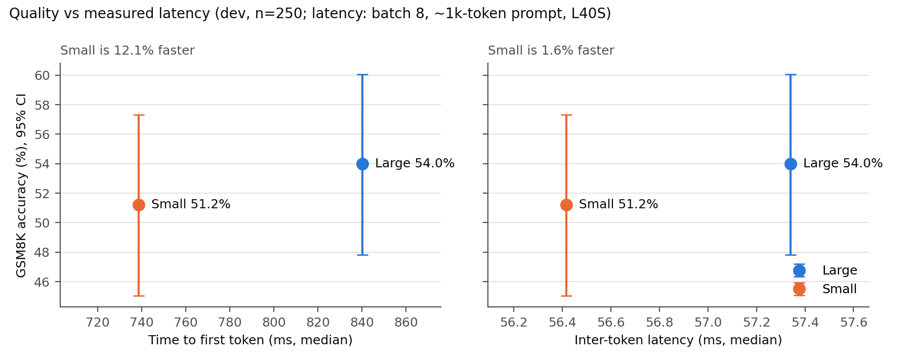
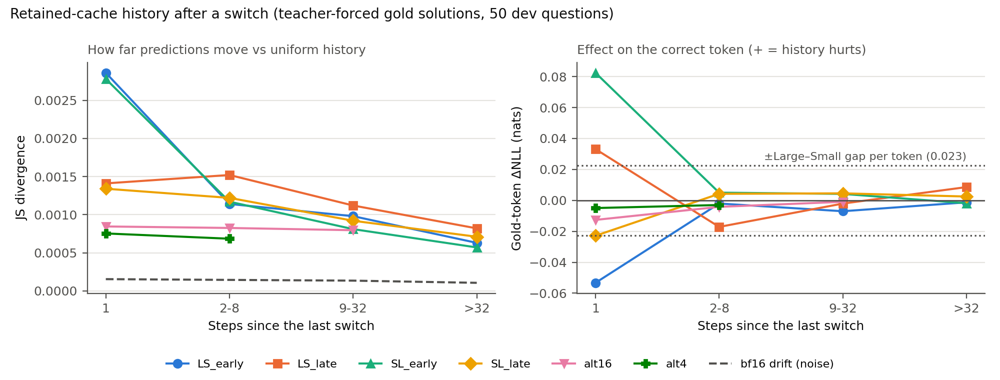

# Week 1: quality and retained-cache transitions

**Question:** which FFN-width configurations and mid-generation switching schedules keep enough task quality for the scheduler to use?

## Setup
- **Model:** Gemma 3n E4B base, revision `af70430f`, bf16, one L40S. Presets: Large (all 35 FFNs at 16384) and Small (Google's E2.98B block config, 20 layers at 8192). Attention and depth are fixed.
- **Task:** GSM8K, 8-shot chain-of-thought, greedy, exact match on the final number. Answers average ~95 tokens, so switches really do happen mid-answer.
- **Splits** (seed 6222): 250 dev, 250 held-out, and the first 50 dev questions as a diagnostic set. The rules were frozen in `manifests/quality_contract.json` before any results.
- **Quality gate** (team-wide): ≤ 5 pp loss vs Large. A schedule is certified only if the 95% paired-bootstrap lower bound is ≥ −5 pp.
- **Batching:** batches of 8, built once by prompt length and reused for every schedule, so paired comparisons see identical padding. The results assume that which requests share a batch doesn't change greedy outputs beyond bf16 noise.
- **Schedules:** one width per step for the whole batch. The KV cache is always retained, so earlier tokens keep the history computed at the old width.
  - `LS`/`SL`: switch Large→Small or Small→Large, either right after prefill (`early`) or at step 64 (`late`).
  - `alt16`/`alt4`: alternate every 16 or 4 steps.
- **Prefill/decode boundary:** the whole prompt is prefilled at one width, and that pass also produces the first answer token. So generated token *i* comes from step *i*, with step 0 being the prefill. In `SL_early`, the first answer token comes from Small and Large takes over from token 2.

## Dev accuracy (n = 250, paired vs static_L)

| Schedule | Accuracy | Δ (pp) | 95% CI | McNemar p | Flips (only L / only schedule right) |
|---|---|---|---|---|---|
| static_L | 54.0 | — | — | — | — |
| static_S | 51.2 | −2.8 | [−8.4, +2.8] | 0.40 | 29 / 22 |
| LS_early | 52.0 | −2.0 | [−7.6, +4.0] | 0.59 | 30 / 25 |
| SL_early | 52.4 | −1.6 | [−6.0, +2.8] | 0.59 | 17 / 13 |
| LS_late | 51.6 | −2.4 | [−5.2, +0.0] | 0.15 | 9 / 3 |
| SL_late | 53.6 | −0.4 | [−5.6, +4.8] | 1.00 | 22 / 21 |
| alt16 | 51.6 | −2.4 | [−6.4, +1.6] | 0.33 | 16 / 10 |
| alt4 | 51.6 | −2.4 | [−6.4, +1.6] | 0.35 | 17 / 11 |

There were no missing answers, and 2–5% of answers hit the 256-token cap in every schedule. The late switches fired on 81% of answers.

The flips are what make the CIs wide. Even though net accuracy barely moves, 20% of questions change outcome between Large and Small. LS_late flips the fewest (12), because its first 64 tokens are identical to Large.

## Logit diagnostics (50 diagnostic questions, teacher-forced gold solutions)
At each step, the mixed-history run is compared with a run at the same width but with uniform history. **Drift** is the ordinary bf16 cache-vs-recompute noise, for scale.

| Steps since switch | JS (LS_early / SL_early) | Drift JS | Top-1 agreement |
|---|---|---|---|
| 1 | 0.0029 / 0.0028 | 0.0003–0.0004 | 96% / 94% |
| 2–8 | 0.0011 / 0.0012 | 0.0002 | 97–99% |
| 9–32 | 0.0010 / 0.0008 | 0.0001–0.0002 | 98% |
| >32 | 0.0006 / 0.0006 | 0.0001 | 99% |

- **The history effect is real but small.** It's about 7–10× the drift on the first step after a switch, falls about 3× within 8 steps, and stays above drift afterwards.
- **The gold-token effect is small and has no consistent direction.** ΔNLL at the first step after a switch is at most about 0.08 nats in size, with signs that differ across schedules (e.g. SL_early +0.082, LS_late +0.033, SL_late −0.023). From step 2 on, it's within about ±0.02.
- **For scale:** full-prefix gold NLL is 0.680 nats per token for Large and 0.703 for Small, a 0.023 gap. A single step right after a switch can move by several times that gap; later steps stay within about the gap itself.
- **Disturbance is largest for switches right after the prompt** (first-step JS 0.0028–0.0029) and smaller for switches later in the answer (late and alternating, 0.0004–0.0014). Predictions also get more confident deeper into an answer, so this doesn't show why.
- Comparing against a full-prefix recompute instead gives the same picture.

## Plots


The latency is the measured end-to-end result from the latency-baselines branch, for the closest cell to these runs (batch 8, ~1k-token prompt, L40S). Small is about 12% faster to the first token and about 1.6% faster per decoded token. Only the static presets appear, because they're the only configurations with measured latency.



Alternating schedules pool both widths in each bucket. The `before` bucket is left out because it's zero by construction.

## What the evidence supports
- **The static configurations (what request-level selection would choose between), infrequent switching and repeated switching (down to every 4 steps) are indistinguishable from each other and from Large at n = 250.** Every switching schedule lands between Small and Large, with no accuracy cost beyond the width mix itself. The logit diagnostics show a small effect that doesn't reach accuracy.
- **Under the strict gate, only Large is certified.** At n = 250 the paired CI is about ±5 pp, because 51 of 250 questions (20%) flip between Large and Small. On point estimates, all schedules are within 5 pp.
- **No direction or frequency restriction is supported by the data** (`results/schedule_restrictions.json`), and there's no per-step quality penalty to model.
- **On GSM8K, quality isn't what separates request-level from iteration-level control.** The case for iteration-level switching rests on whether narrower FFNs give a real decode speedup.

## Needs more data / not done
- **Held-out confirmation is pending.** The single held-out run (static_L, static_S, SL_early, alt4, chosen from the dev results) is submitted.
- Resolving gaps under ~5 pp needs a narrower CI. Halving its width takes about 4× the questions; 819 GSM8K test questions are still unused.
- No request-level policy was run; only its two static endpoints were.
- **One task and one model.** The SQuAD pilot showed a larger Large–Small gap (6.5 pp), so the gap depends on the task.
- The diagnostics report means over 50 questions, without CIs.

## Reproduce (PACE, from `week1/quality/code`)
```bash
python prepare_data.py                      # CPU; regenerates manifests/ (already committed)
python run_generation.py --split dev        # default: static_L, static_S, LS_early, SL_early; prints its run ID
python run_generation.py --split dev --run-id gen-dev-20261001-205536 --schedules LS_late,SL_late,alt16,alt4
python score.py --run-id gen-dev-20261001-205536   # quality_table.csv, scored.jsonl
python teacher_forced.py                    # diagnostics_summary.csv
python test_schedules.py && python test_score.py && python test_teacher_forced.py   # CPU tests
```
Plots (CPU, any machine with matplotlib):
```bash
git show origin/latency-baselines:week1/latency-baselines/results/s4_end_to_end.csv > /tmp/s4_end_to_end.csv
python plots.py --latency-csv /tmp/s4_end_to_end.csv
```
Runs: `results/gen-dev-20261001-205536` (generation) and `results/diag-dev-20261002-134051` (diagnostics). Per-example data is in `generations.jsonl` (text, run-length `width_history` per step) and `scored.jsonl` (prediction, gold, correct). Each has a `manifest.json` with the command, commit, seed, revisions, hardware and package versions.
