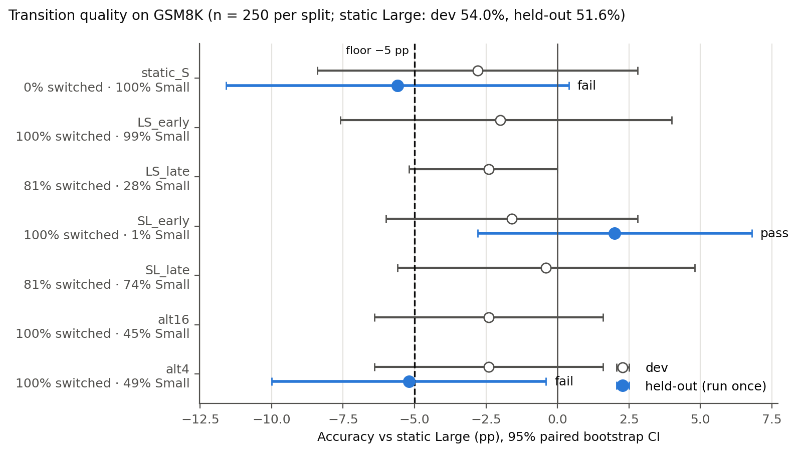
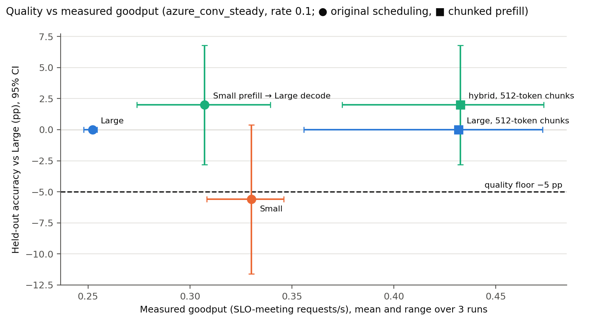

# Week 2: quality floor for load-driven transition schedules

**Question:** which width schedules a load-driven policy would use keep GSM8K quality within the ≤ 5 pp floor on held-out data?

**Answer:** only one: Small prefill, then Large for every decoded token (`SL_early`, the phase hybrid). Small decode and repeated switching both fail on held-out. The scheduler-facing rules are in [`allowed_transitions.json`](allowed_transitions.json).

## Setup
Same frozen harness as Week 1 (see `week1/quality/README.md`). The gate passes a schedule only if the 95% paired-bootstrap lower bound on Δ vs static_L is ≥ −5 pp.

Protocol: all eight schedules were run on dev (n = 250). Four were picked from dev for held-out: the two static references, the phase schedule, and the densest repeated switching (`alt4`). Held-out (n = 250, disjoint from dev) was run **once**, from committed code (`9d004cc`, clean tree), before any held-out result was seen.

## Results

| Schedule | Dev Δ (pp) [95% CI] | Held-out acc | Held-out Δ (pp) [95% CI] | McNemar p | Flips (only L / only sched) | Floor |
|---|---|---|---|---|---|---|
| static_L | — (54.0) | 51.6 | — | — | — | ref |
| SL_early | −1.6 [−6.0, +2.8] | 53.6 | +2.0 [−2.8, +6.8] | 0.51 | 16 / 21 | **pass** |
| static_S | −2.8 [−8.4, +2.8] | 46.0 | −5.6 [−11.6, +0.4] | 0.09 | 37 / 23 | fail |
| alt4 | −2.4 [−6.4, +1.6] | 46.4 | −5.2 [−10.0, −0.4] | 0.047 | 25 / 12 | fail |

No missing answers; 2–4% of answers hit the 256-token cap; every switching schedule switched on 100% of requests. Dev-only schedules (`LS_early`, `LS_late`, `SL_late`, `alt16`) are in the Week 1 README and are not certified.

Pooled over both splits (500 questions, descriptive only, not the gate test): SL_early +0.2, static_S −4.2, alt4 −3.8 pp.

- **SL_early behaves like Large.** 99% of its steps run at Large, and its pooled flips are balanced (33 / 34). The +2.0 on held-out is favorable noise, not a gain.
- **Decoding at Small costs about 4 pp**, close enough to the floor that one 250-question sample passes it on point estimate (dev) and the other fails (held-out).
- **alt4 is the only schedule significantly worse than Large.** About half its steps are Small and it lands near static_S. These runs can't separate the switches from the Small share; Week 1 diagnostics found the post-switch history effect small, which points to the Small share.

## Batch noise floor
The same 48 dev questions at batch 1 vs batch 8 (static_L): 4 predictions differ (8%) and 2 change correctness (29 vs 31 correct). Batch composition alone moves bf16 greedy outputs. Paired comparisons are unaffected, since every schedule used identical batches.

## Supported level of control
| Level | Held-out evidence |
|---|---|
| Request-level (static L or S per request) | only Large; static Small fails |
| Infrequent switching | one Small → Large switch right after prefill passes |
| Repeated switching | fails (alt4) |

The scheduler rules are in `allowed_transitions.json`. This certifies the phase hybrid measured by the mixed-serving harness, so quality no longer blocks that configuration; whether it beats a chunked-prefill Large baseline is a speed question, not a quality one.

## Plots




Goodput is from the mixed-serving harness (circles) and the chunk-check replay (squares), both on `azure_conv_steady` at rate scale 0.1 with the same SLO (TTFT ≤ 1 s, max ITL ≤ 200 ms), 3 runs each. It's computed as attainment × throughput for both sources, which is within 0.01 req/s of each source's own goodput number. Quality is the held-out Δ of the matching width schedule; chunked configurations reuse it, since chunking doesn't change the width history. With chunked prefill, Large reaches the hybrid's goodput with no quality question at all.

## Limits
- One task, one model, n = 250 per split.
- Large → Small schedules and alt16 were never run on held-out. Block k = 1 alternation was not run; alt4 already fails, so it can't loosen the rules.
- The serving harness's prompts aren't GSM8K, so its quality is inferred from running the same width schedule, not measured on its own outputs.

## Reproduce (PACE, from `week1/quality/code`)
```bash
python run_generation.py --split heldout --schedules static_L,static_S,SL_early,alt4   # run once
python run_generation.py --split dev --limit 48 --batch-size 1 --schedules static_L    # batch check
python score.py --run-id gen-heldout-20261004-204404
python score.py --run-id gen-dev-20261004-203609
```
Plots (CPU, from the repo root; the goodput CSVs aren't on main yet):
```bash
git show origin/mixed-serving:week2/mixed-serving/results/analysis/runs.csv > /tmp/serving_runs.csv
git show origin/yixuan:week2/chunk-check/results/analysis/runs.csv > /tmp/chunk_runs.csv
python week2/quality/code/plots.py --serving-runs /tmp/serving_runs.csv --chunk-runs /tmp/chunk_runs.csv
```
Runs: `week1/quality/results/gen-heldout-20261004-204404` (held-out) and `gen-dev-20261004-203609` (batch check); dev comparison in `gen-dev-20261001-205536`. Each folder has a `manifest.json` with command, commit, seed, revisions and hardware.
