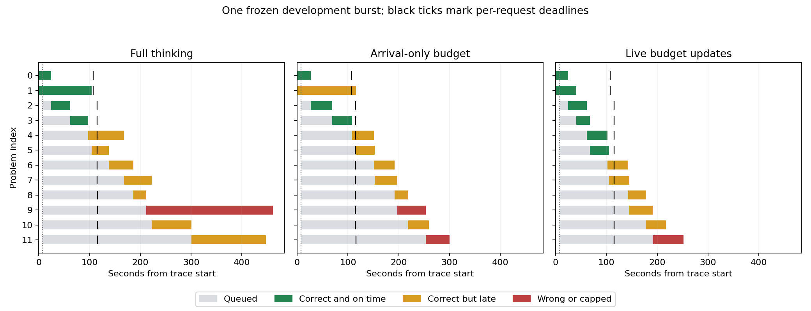

# Controlled burst-policy comparison

## Outcome

**The live-update policy passed the frozen preliminary screen on this one development burst.** It produced six correct answers before their deadlines, compared with four for full thinking and three for arrival-only budgeting. It retained the same aggregate completed correctness as full thinking: 11 of 12.

This is encouraging evidence for continuing Russ's idea at a preliminary level. It is a result for the combined live policy: some changes happened during generation and others at admission. It does not yet isolate the extra value of interrupting ongoing generation over making decisions at admission.

## Results

All policies received the same 12 problems and frozen arrival trace. Each request had a 107.6-second relative completion deadline. Late requests were allowed to drain so eventual correctness could also be measured.

| Metric | Full thinking | Arrival-only | Live updates |
| --- | ---: | ---: | ---: |
| Correct and completed on time | 4/12 | 3/12 | **6/12** |
| Correct and completed overall | 11/12 | 10/12 | **11/12** |
| Correct on-time answers/minute, common observation window | 2.08 | 1.56 | **3.12** |
| Median completion latency | 169.4 s | 164.8 s | **116.4 s** |
| Mean queue delay | 119.9 s | 117.5 s | **81.9 s** |
| Time to drain the trace | 461.3 s | 299.8 s | **251.9 s** |
| Thinking-cap failures | 1 | 0 | 0 |
| Answer-cap failures | 0 | 0 | 1 |
| Completed wrong answers | 0 | 2 | 0 |

Live updates delivered two more correct on-time answers than full thinking and three more than arrival-only. Its median completion latency was 31.3% lower than full and 29.4% lower than arrival-only. Its drain time was 45.4% lower than full and 16.0% lower than arrival-only.

The primary deadline count uses server final-output readiness relative to scheduled arrival, matching calibration. Using client-received completion instead gives the same 4, 3, and 6 counts. The common observation window is 115.5 seconds; drain time is separate. Maximum client injection lag was under 1.7 ms, compared with the 50 ms burst spacing.

## What the controller actually did

Both adaptive policies assigned short budgets to eight requests at arrival. The live policy additionally reduced four active requests' budgets:

| Problem index | Generated tokens when reduced | What happened |
| --- | ---: | --- |
| 0 | 483 | Closed thinking naturally before reaching 2,048; the reduction did not bind. |
| 1 | 484 | Reached 2,048, received the cue, and finished with a correct answer. This is the binding mid-generation cutoff. |
| 2 | 0 | Reduced at worker admission; later reached the budget and received the cue. |
| 3 | 0 | Reduced at worker admission; closed naturally before reaching the budget. |

Problem 1 is the clearest direct example: the summation request finished correctly in **40.8 seconds** with live updates, compared with **104.4 seconds** under full thinking and **116.1 seconds** under arrival-only. Its first 2,048 generated tokens matched across the policies before the intervention. The live policy released that occupied slot earlier.

Compared with full thinking, live updates preserved all four already-on-time correct answers and brought problems 4 and 5 inside their deadlines. The timeline is consistent with earlier capacity release helping queued work. The current experiment measures the combined policy and cannot partition all of that benefit between the binding mid-generation cutoff, admission-time changes, and subsequent generation differences.

## Quality was preserved in aggregate, with an exchanged failure

The live policy did not get exactly the same eleven problems right as full thinking:

- **Problem 9, parenthesization:** full thinking hit its safety cap without a final answer. Live updates finished correctly with 4, though after the deadline. Arrival-only finished with an incorrect 8.
- **Problem 11, polynomial interpolation:** full thinking eventually returned the correct 3/56. Live updates exhausted the answer allowance while still calculating, without a final boxed answer. Arrival-only finished with the incorrect 5047/63.

The one rescued failure offset one lost correct answer. That meets the predeclared aggregate screen, but it is not evidence that every shortened request is safe. All four primary failures and both exchanged outcomes were reviewed against their raw outputs; no grading corrections were needed and no parser issues were reported.

## Controls and resource use

The [protocol](burst-policy/PROTOCOL.md) and [specification](burst-policy/spec.json) were frozen before execution:

- First 12 MATH-500 development indices, no correctness filtering; one sample per problem/policy and the same per-problem seeds.
- Same pinned Qwen3-4B checkpoint, BF16, vLLM 0.11.2, one H100, two active sequences, one engine, and unchanged stock scheduling decisions.
- Same 2,048-token short budget, exact Stage 3 cue, sampling settings, thinking safety limit, and answer allowance. Full-thinking safety failures did not receive a rescue cue.
- Same logged post-schedule waiting-queue signal. Arrival-only decided at HTTP arrival. Live also acted on active thinking requests. Prefix caching was disabled and streaming used delta metadata for all policies.
- Two calibration requests fixed the burst at 7.4 seconds and the relative deadline at 107.6 seconds before the measured phases. Ten burst arrivals were spaced across 0.45 seconds. The seeded policy order was arrival-only, live, full; each phase fully drained.

Job **6320907** completed with exit **0:0**. It used **one H100 for 21 minutes 4 seconds** (1,264 allocation seconds, about 0.351 GPU-hours), including startup, calibration, and all three policies. There were **38 total attempts: two calibration and 36 measured**. No repeats, retries, extensions, or additional GPU experiments were launched. The job exited and the account queue was empty at the completion check.

CPU auditing verified executed source hashes, the frozen trace hash and timing, identical inputs/seeds, all 38 admissions, queue decisions against scheduler snapshots, exact cue sequences, cap boundaries, no reopened thinking, monotonic computed-token counts, retained sampled KV block prefixes, and zero preemptions.

## Interpretation and next boundary

The result passes all three conditions fixed before execution: a binding cutoff on an already-generating request, more correct on-time answers than both baselines, and no fewer completed-correct answers than full thinking on this trace.

It supports the practical possibility behind Russ's proposal: load feedback can shorten an active request and improve useful completions in a burst. The next unresolved comparison is **admission-only budgeting versus live updates**, because two extra reductions here occurred at admission. An admission-only control is needed before attributing the observed policy advantage specifically to mid-generation intervention.

This remains one small development trace. One answer is 8.3 percentage points, so equal 11/12 scores cannot establish the earlier three-point accuracy tolerance. Only 8 of 24 full-versus-adaptive prefix comparisons matched exactly before cutoff or natural closure; many later responses diverged earlier despite fixed seeds. Changing batch composition/numerics is a plausible explanation, but the cause was not isolated. Treat the exchanged correctness outcomes as observed policy results, not clean per-problem causal estimates of the cue alone.

The service also uses eager execution, per-step file-based queue publication, and tracing. Improvements apply to this instrumented harness. It has not established optimized production throughput, a population quality floor, or robustness across traces and policy orders. No larger run is automatically authorized by this result.

## Evidence

- [Scored summary and decision screen](burst-policy/results/job-6320907/analysis/summary.json)
- [Per-request results](burst-policy/results/job-6320907/analysis/per-request.csv) and [graded records](burst-policy/results/job-6320907/analysis/graded.json)
- [Manual audit, no score changes](burst-policy/results/job-6320907/analysis/manual-audit.json)
- [Frozen derived trace](burst-policy/results/job-6320907/trace.json) and [freeze hash](burst-policy/results/job-6320907/trace-freeze.json)
- [Runtime/source manifest](burst-policy/results/job-6320907/manifest.json), [analysis manifest](burst-policy/results/job-6320907/analysis/analysis-manifest.json), and [Slurm accounting](burst-policy/results/accounting-6320907.txt)
- [Worker decisions](burst-policy/results/job-6320907/worker.jsonl), [queue/cache audit](burst-policy/results/job-6320907/scheduler.jsonl), and [prefix diagnostics](burst-policy/results/job-6320907/analysis/prefix-checks.json)
- [Timeline PNG](burst-policy/results/job-6320907/analysis/timeline.png) and [PDF](burst-policy/results/job-6320907/analysis/timeline.pdf)

Raw outputs and executed sources remain under `burst-policy/results/job-6320907/`. [README](burst-policy/README.md) describes execution and CPU-only reproduction of the audit and scoring.
