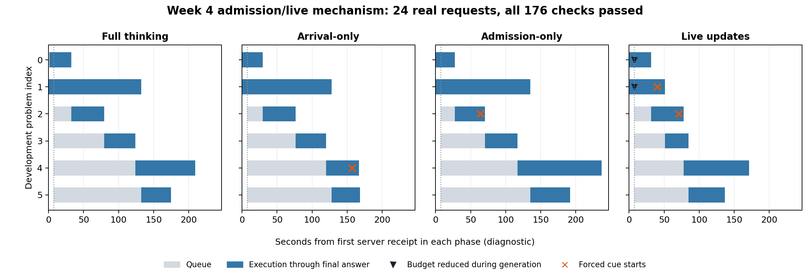

# Step 1 passed — October 21, 2026

**Real concurrent GPU validation passed: 176/176 checks, 24 requests, four
policies, zero caps or preemptions.** Controlled comparison job 6440653 was
submitted immediately afterward. This gate is engineering evidence, not an
accuracy or serving-goodput result.

## What the GPU run established

Job [6440402](results/job-6440402/validation.json) ran Qwen3-4B on one H100 80GB
with pinned vLLM 0.11.2, BF16, two active slots, stock scheduling, and six exposed
development questions per mode.

| Policy | Normal completions | Initial short budgets | Later revisions | Forced cue starts |
| --- | --- | --- | --- | --- |
| Full thinking | 6/6 | 0 | 0 | 0 |
| Arrival-only | 6/6 | 2 | 0 | 1 |
| Admission-only | 6/6 | 2 | 0 | 1 |
| Live updates | 6/6 | 2 | 2 | 2 |

One of the two live cue starts was a **binding mid-generation cutoff**; the
other came from an initial short admission budget. One later live reduction
did not bind because thinking closed naturally first. These are distinct counts.

`live-01` began at 16,384 tokens. At 331 generated tokens its budget was reduced
to 2,048. It reached that limit, emitted the exact 14-token cue, continued with
590 tokens after the full cue (including terminal EOS), and finished normally
with 2,652 total tokens. Its output-list identity remained unchanged. Scheduler
computation stayed monotonic, sampled KV block prefixes were retained, and no
preemption occurred. This supports in-place continuation; it is not a bitwise
cache-tensor comparison.

Admission-only requests 2 and 3 received short budgets at first scheduling;
requests 4 and 5 received long budgets after pressure fell. All worker
initializations had zero generated tokens and matched admission metadata.
Admission-only had no later revisions. Admission/live use the same function for
the same snapshot; separate policy runs need not have identical queue histories.

[PNG](results/job-6440402/analysis/mechanism-timeline.png) ·
[PDF](results/job-6440402/analysis/mechanism-timeline.pdf)

The timeline uses actual server receipt and same-host server/worker/scheduler
monotonic events. It is not the client-clock deadline metric of the comparison.

## Implementation and independent checks

The [admission-boundary note](ADMISSION-BOUNDARY.md) traces the installed engine
interfaces. Stock scheduling is unchanged. Decisions travel in
`NewRequestData.sampling_params.extra_args` before dispatch; the worker does not
reconstruct initialization from a later snapshot. Only live reduces after
positive generation progress and before closure. Week 3 forcing and caps remain.

- 21 CPU checks passed locally and on PACE.
- [176 GPU checks](results/job-6440402/validation.json) passed on PACE and local
  readback.
- All [eight corruption checks](checks/validator-regressions.json) rejected bad
  evidence, including admission revisions, missing live cuts, changed trace/source
  hashes, caps, early worker progress, and incomplete runs.
- Exact candidate, dataset, and protocol hashes enter the comparison
  [as-run gate record](../controlled-comparison/results/job-6440653/gate.json).

## Preserved attempts and compute

| Job | Allocated time | Generated requests | Outcome |
| --- | --- | --- | --- |
| [6434655](results/job-6434655/diagnosis.json) | 14 s | 0 | Upload metadata rejected by source inventory. |
| [6434705](results/job-6434705/diagnosis.json) | 245 s | 0 | Four-minute guard expired during slow startup. |
| [6440402](results/job-6440402/accounting.txt) | 1,093 s (18:13) | 24 | All 176 GPU checks passed. |

Earlier failures remain preserved. The user then authorized realistic budgets
and continuation; see [the renewed session plan](../EXPERIMENT-SESSION.md).
Total Step 1 allocation including earlier failures: 1,352 GPU-seconds (22:32,
approximately 0.376 GPU-hours). No policy tuning was made between attempts.

## Next checkpoint

The [controlled comparison is complete](../controlled-comparison/REPORT.md),
job 6440653: live 12/24 correct-on-time outcomes versus admission 8/24, over 12
unique development problems in two reverse-order matched blocks. Client receipt
is primary; caps and errors fail. Do not infer a general accuracy guarantee from
this small development comparison or from the mechanism gate.

All new artifacts are under Week 4 on local branch `codex/week4-admission-control`.
Existing unrelated Week 3 edits remain untouched. No GitHub push was performed;
automatic approval review previously required authorization for that destination.
