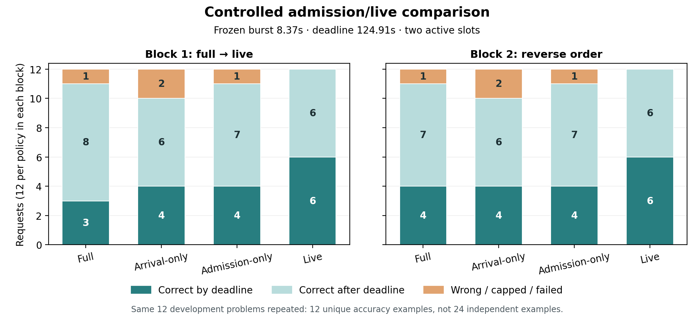

# Live updates add deadline completions beyond admission-only in this development trace

**Live delivered 12/24 correct-on-time outcomes versus 8/24 for admission-only,
with a gain of two in each block.** Eventual completed correctness was 24/24
versus 22/24. Median client completion time fell from 166.4s to 120.0s (27.9%).
The predeclared development continuation screen passed.

These are **two replays of the same 12 exposed development problems**, not 24
independent accuracy examples. This supports further validation of the candidate;
it does not establish a population benefit or a three-point accuracy guarantee.

## Controlled result

Job **6440653** completed with exit code 0 after **58:24** on one H100 80GB.
It collected two excluded calibration requests and all 96 measured outcomes.
All four policies used the same engine, hardware, prompts, sampling seeds,
generation limits, instrumentation, traffic, and deadlines. Admission/live
shared the initial rule, and all 24 paired initial budget choices matched.

| Policy | Correct on time /24 | Eventual correct /24 | Median client time | P95 client time | Mean queue time | Binding live cutoffs |
| --- | --- | --- | --- | --- | --- | --- |
| Full thinking | 7 | 22 | 192.0s | 542.6s | 136.7s | 0 |
| Arrival-only | 8 | 20 | 160.2s | 287.9s | 114.6s | 0 |
| Admission-only | 8 | 22 | 166.4s | 365.1s | 118.2s | 0 |
| Live updates | **12** | **24** | **120.0s** | **337.4s** | **84.6s** | **2** |

Client time is terminal receipt minus scheduled arrival on the replay client's
clock. Latency summaries include terminal responses that are late, wrong, or
capped; P95 uses nearest rank on only 24 outcomes. Queue time is a separate
same-host server diagnostic. No request is dropped from the accuracy denominator.

| Matched block | Policy order | Full on time /12 | Arrival /12 | Admission /12 | Live /12 | Live − admission |
| --- | --- | --- | --- | --- | --- | --- |
| 0 | full, arrival, admission, live | 3 | 4 | 4 | 6 | +2 |
| 1 | live, admission, arrival, full | 4 | 4 | 4 | 6 | +2 |

In each block eventual correctness was full 11/12, arrival 10/12, admission
11/12, and live 12/12. The full-thinking deadline count varied across blocks,
showing why one execution order is insufficient. The admission/live difference
was the same in both blocks.

[PNG](results/job-6440653/analysis/controlled-outcomes.png) ·
[PDF](results/job-6440653/analysis/controlled-outcomes.pdf) ·
[machine-readable summary](results/job-6440653/analysis/summary.json) ·
[per-request grades](results/job-6440653/analysis/graded.json)

## What explains the deadline gain

The same two queued problems, **4 and 5**, were correct under both admission and
live, but reached the deadline only with live in each block. There were no paired
deadline losses. Their client completion times were:

| Block / problem | Admission | Live | Relative deadline |
| --- | --- | --- | --- |
| 0 / 4 | 140.9s | 97.1s | 124.91s |
| 0 / 5 | 154.5s | 99.6s | 124.91s |
| 1 / 4 | 136.6s | 97.9s | 124.91s |
| 1 / 5 | 149.8s | 100.6s | 124.91s |

Request 1 matched admission-only's first 2,048 generated tokens in both blocks.
Live reduced its initial 16,384-token budget after 517/527 generated tokens,
then forced the exact cue at 2,048 and let the answer finish normally. It
finished about 42s from first server receipt in each live phase, compared with
123s/119s for admission. Queued request 3 was admitted immediately after that
live final; requests 4/5 were subsequently admitted earlier.

This event sequence supports useful capacity release. Later sampled trajectories
and generation lengths also changed, so the logs do not attribute every second
of difference to the cue alone. The primary evidence is the matched correct
deadline outcomes, with the event chain explaining a plausible mechanism.

The extra eventual-correct answer was **problem 9**, repeated in both blocks:
admission answered 2 and live answered the reference 4. Both started at 2,048,
and this problem had no own live revision. Their generated prefixes diverged
after 109 tokens. This observed accuracy gain is not direct evidence that an
interruption improved mathematical reasoning; changing batching can change
sampled outputs despite identical seeds. No mathematical or extraction correction
was applied. See [the complete paired cases](results/job-6440653/analysis/cases.json).

## Protocol, failures, and validation

The [plan](PLAN.md), [specification](results/job-6440653/spec.json), candidate
hashes, input hashes, policy orders, success criteria, and resource limits were
saved before measurement. Two concurrent full-thinking calibration requests
(indices 0 and 2) took 33.48s/62.46s on the client clock. The fixed rule produced:

- Late burst at **8.37096s**, then 0.05s spacing for indices 2–11.
- Relative deadline **124.91236s** for every measured request.
- Fixed observation horizon **133.73332s** per policy/block, **267.46663s** combined.

Window-defined deadline goodput was **2.692 correct/min for live** versus
**1.795 for admission-only** (counts 12 versus 8 over the same combined window).
This is not throughput averaged over the entire allocation or a production claim.
Late requests drained under common safety limits.

The offline audit verified complete coverage, source/input locks, the calibration
rule and trace freeze before measurement, identical open-loop schedules,
generation before each burst, overlap, queue decisions, admission before initial
generation, live-only changes, exact cue tokens, request identity, no reopened
thinking, monotonic computation, sampled KV-prefix retention, and zero preemption.
There were **zero parser issues, runtime errors, cancellations, or missing finals**.
Two full-thinking responses hit the thinking cap and counted as failures. Six
other measured responses were normally completed wrong answers; none was hidden.

Generated output tokens were full **119,252**, arrival **69,530**, admission
**86,856**, live **78,592**. Raw output totals include terminal/special tokens.
Detailed phase counters and failures are retained in the summary. The 72.7 MB
scheduler log is stored losslessly as gzip with raw/compressed hashes; plaintext
is retained locally and on PACE. Materialization reproduced byte-identical events
and an identical final analysis: [storage audit](results/job-6440653/analysis/storage-roundtrip.json).
The [final record check](results/job-6440653/analysis/final-record-check.json)
also verifies coverage, paired initial choices, source provenance, figure/table
numbers. The original provisional readback was also checked before packaging; duplicate intermediate records remain on PACE.

## Scope, uncertainty, and decision

The candidate passes the saved screen: more live deadline successes overall,
no block with a negative deadline difference, a binding live cutoff in each
block, and eventual quality within the planned limit. Retain the candidate and
move to reserved-question/traffic validation without tuning it to these results.

The evidence covers one late-burst trace, 12 already exposed development
questions, reused sampling seeds, two reverse-order blocks, one model/GPU type,
two active slots, eager execution, and detailed file-based instrumentation.
The repeated questions and consistent block deltas do not establish independent
accuracy samples or general serving uncertainty. No held-out campaign, other
traffic conditions, production throughput measurement, or closest-method
comparison was run. Novelty and a small accuracy-loss guarantee remain unresolved.

## Compute and reproduction

Renewed 1C job 6440402 used **18:13**; this comparison used **58:24**. Total renewed
allocation was **1:16:37 = 1.277 GPU-hours**, including startup, calibration, and
drain. Including the two earlier preserved setup failures gives **1:20:56 =
1.349 GPU-hours**. No inference retries or policy tuning occurred during the
comparison. No jobs remain active.

Runtime: Qwen3-4B revision `1cfa9a7208912126459214e8b04321603b3df60c`, vLLM 0.11.2,
Torch 2.9.0, Transformers 4.57.6, BF16; Math-Verify 0.9.0 in a separate analysis
environment. Exact sources, package inventory, hardware, inputs, raw responses,
events, trace, grades, and accounting are in [the run directory](results/job-6440653/).
Use the [README commands](README.md) to materialize and reproduce the analysis.
All new work is under Week 4; unrelated Week 3 edits remain untouched.
