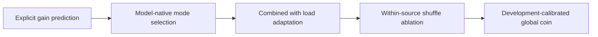
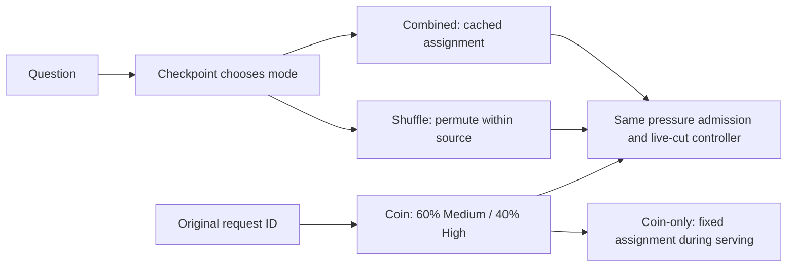

# Presentation figures and sequence

Start with the original question and finish with the practical baseline that the ablation motivated.

| Slide | Figure | Message |
|---|---|---|
| 1 | Research progression above | Budget sensitivity motivated prediction, then trainable routing, then the serving ablation. |
| 2 | [Offline accuracy–compute](figures/offline-frontier.svg) | The global coin competes with learned routing and source shuffle on archived paired choices. |
| 3 | [Allocation opportunity](figures/allocation-opportunity.svg) | Ten High-only successes and two Medium-only successes. The router captured four and selected High for both regressions. |
| 4 | Policy diagram above and [specification](integration/POLICIES.md) | Cached combined, roster-dependent shuffle, and deployable global coin share a scheduler. |
| 5 | [Eight-slot sustained](figures/sustained-eight.svg) | Combined clears the point target versus task-only. At the same goodput, shuffle seed 151 uses fewer tokens. |
| 6 | [Final live coin](figures/probabilistic-live.svg) and [full matched table](FINAL-REPORT.md) | Load adaptation reduces tokens and latency, with lower eventual accuracy on both seed pairs. |
| 7 | [Research conclusion](RESEARCH-NARRATIVE.md) | Allocation headroom is real. The tested learned router showed no consistent within-source advantage. Results are limited by workload and draw counts, with cached learned routes and some separate-node comparisons. Agent task success remains untested. |

Regenerate with `python3 week9/adaptive-reasoning/figures/build.py` in an environment with matplotlib 3.9.2. The [source archive](results/closeout/evidence.json) carries job IDs, valid summaries, exact replay offsets and generation seeds, compact per-request results, training summaries and offline comparisons. The generated [CSV](results/closeout/live.csv) preserves each arm and block separately. The [paired CSV](results/closeout/paired.csv) records on-time gains and losses and the original point-estimate criterion. Fixed 4K's short-cap count denotes an assigned cap, rather than a pressure intervention. Blank fields indicate metrics missing from the archived summary.
